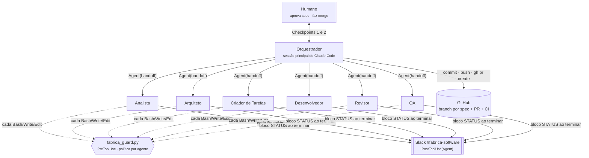

# Fábrica de Software Agêntica no Claude Code

Adaptação da [Fábrica de Software Agêntica Semi-autônoma](https://github.com/andremenegassi/fabrica-software-agentica)
(criada para o opencode) para o **Claude Code**, preservando agentes, responsabilidades, fluxo E0→E8, GitHub Spec Kit
e os dois checkpoints humanos. Cada subagente registra no **Slack** a finalização da sua tarefa.

Projeto Final 4 da disciplina · demonstração no repositório [todo-app](https://github.com/mateusscs/todo-app).

## Por que Claude Code

O Claude Code tem equivalentes diretos para quase todos os mecanismos da fábrica original, o que permitiu
**reaproveitar os prompts sem reescrevê-los**: um script converte os 7 arquivos originais e só o cabeçalho muda.

| Fábrica no opencode | Fábrica no Claude Code |
|---|---|
| `agents/fabrica-software/*.md` | `.claude/agents/*.md`, gerados por [`scripts/converter.py`](scripts/converter.py) a partir de [`original/`](original/) |
| Orquestrador `mode: primary` | `"agent": "orquestrador"` em `.claude/settings.json`: a sessão principal já abre como orquestrador |
| Subagentes `mode: subagent` | Subagentes do Claude Code (ferramenta **Agent**), que começam sem contexto, como o handoff pressupõe |
| `permission.task` com `ask` no Arquiteto | `permissions.ask: ["Agent(subagent-arquiteto)"]`: o humano confirma antes do plano técnico |
| `permission.bash` / `permission.edit` por agente | Hook `PreToolUse` [`fabrica_guard.py`](.claude/hooks/fabrica_guard.py) aplicando a política extraída dos cabeçalhos originais ([`policy.json`](.claude/fabrica/policy.json)), com a mesma semântica "vale a última regra que casar" |
| Bloqueio global de merge/force push | `permissions.deny` em `.claude/settings.json` |
| Spec Kit para opencode | `specify init --integration claude`, que instala as skills `speckit-*` com os mesmos nomes usados nos prompts |
| `model` por papel | `model` no cabeçalho: Desenvolvedor `sonnet`, Revisor `opus`, QA `haiku` (pares produtor/verificador com modelos diferentes) |
| *(novo)* registro no Slack | Hook `PostToolUse` da ferramenta Agent [`slack_notify.py`](.claude/hooks/slack_notify.py): quando cada subagente devolve o resultado ao orquestrador, o hook lê o bloco `STATUS` e posta no canal |

## Arquitetura



O fluxo, os critérios de avanço, o `state.json` e o contrato de handoff são os da fábrica original
(ver [`original/orquestrador.md`](original/orquestrador.md)).

## Instalação em um projeto

Pré-requisitos: Git, [GitHub CLI](https://cli.github.com/) autenticada (`gh auth login`), Python 3, Node.js e
[uv](https://docs.astral.sh/uv/) para o Spec Kit. O projeto precisa estar no GitHub, com pelo menos um commit.

```bash
# 1. No projeto: GitHub Spec Kit com integração Claude Code (skills speckit-*)
uv tool install specify-cli --from git+https://github.com/github/spec-kit.git
specify init --here --force --non-interactive --integration claude --script ps

# 2. Fábrica (agentes, hooks, política e settings)
python <este-repositório>/scripts/instalar.py <caminho-do-projeto>

# 3. Constituição do projeto (rodada pelo humano)
claude "/speckit-constitution <princípios do projeto>"
```

Para o Slack, crie um app com **Incoming Webhooks** no seu workspace e cole a URL em
`.claude/settings.local.json` → `env.SLACK_WEBHOOK_URL` (arquivo local, fora do Git).

## Uso

Abra `claude` na pasta do projeto: o agente ativo já é o orquestrador.

```text
@agent-subagent-analista-requisitos Nova feature. ...      # E1 · especificação (para no Checkpoint 1)
Aprovo a especificação, mas não siga com o arquiteto.        # registra a aprovação e para
Implemente a spec 001-<nome>.                                # E2 → E7 · zona autônoma até o PR com CI verde
```

## Reconvertendo a partir da fábrica original

Se os prompts originais mudarem, copie-os para `original/` e rode:

```bash
python scripts/converter.py original .claude
```

## Créditos

Fábrica original: [André Menegassi](https://github.com/andremenegassi/fabrica-software-agentica).
Adaptação para Claude Code: Mateus Cunha e Daniel dos Santos.
